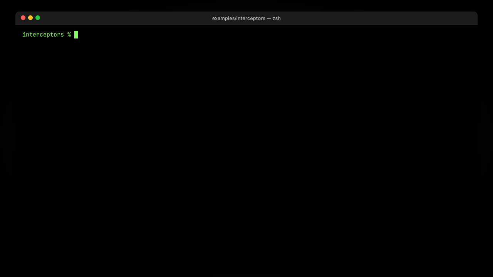

# Interceptors

`interceptors.v1.WhoamiService/Whoami` behind two server interceptors, and a client that runs
interceptors of its own:

- `Logging` counts each call it sees and each that fails, and sets a response header;
- `Auth` refuses a call with no bearer token with `unauthenticated`, and puts the caller in a
  trailer;
- the client's `BearerToken` adds the token, and `Log` prints each response's HTTP status and
  protocol;
- the client's `Count` counts each response in the program's `Tally`, through the context each
  call's `init` takes (decision 44).



Whoami has no side effects, so a Connect client may also send it as a GET.

## Files

| Path | Holds |
| --- | --- |
| [proto/interceptors/v1/interceptors.proto](proto/interceptors/v1/interceptors.proto) | The schema |
| [src/service/service.zig](src/service/service.zig) | Whoami, `Logging` and `Auth` |
| [src/app.zig](src/app.zig) | This example's `App` and route table |
| [src/main.zig](src/main.zig) | The check, over h2 and h3 |
| [src/serve.zig](src/serve.zig) | The same routes on a socket, to play with |

## Run it

```sh
zig build run
```

## Play with it

```sh
zig build serve
```

From this folder:

```sh
curl -i --cacert ../harness/tls/ca.pem -H 'authorization: Bearer Ada' --json '{}' \
  https://127.0.0.1:8443/interceptors.v1.WhoamiService/Whoami
```

It answers `{"name":"Ada"}`, with the headers `demo-logged: yes` and `trailer-whoami-caller: Ada`.
From the second call on, the answer also counts the calls before it. With no `authorization`
header, the call fails with 401 and `unauthenticated`. The same call as a GET:

```sh
curl --cacert ../harness/tls/ca.pem -H 'authorization: Bearer Ada' \
  'https://127.0.0.1:8443/interceptors.v1.WhoamiService/Whoami?encoding=json&message=%7B%7D'
```
