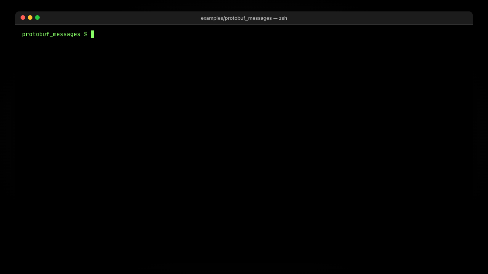

# Protobuf messages

Generated messages in binary and in proto3 JSON, with no RPC: the `protobuf` module alone.
`kitchen.Tree` holds every shape the plugin writes, from maps and oneofs to recursion and
well-known types. The program builds one, encodes it in binary and in JSON, decodes both, and
checks each value.



## Files

| Path | Holds |
| --- | --- |
| [proto/kitchen/v1/kitchen.proto](proto/kitchen/v1/kitchen.proto) | Every shape the generator writes |
| [proto/kitchen/v1/shared.proto](proto/kitchen/v1/shared.proto) | Messages that `kitchen.proto` and `large.proto` import |
| [proto/large/v1/large.proto](proto/large/v1/large.proto) | A file of many wide messages, which the plugin writes as one file |
| [src/main.zig](src/main.zig) | The program |
| [src/generated_test.zig](src/generated_test.zig) | A test that compiles every generated declaration |

A generated file reaches another by module name, and its header names the modules it needs. The
build gives `kitchen.pb.zig` and `large.pb.zig` the module `kitchen_v1_shared`.

## Run it

```sh
zig build run
```

`zig build test` runs the program and compiles every generated declaration.
