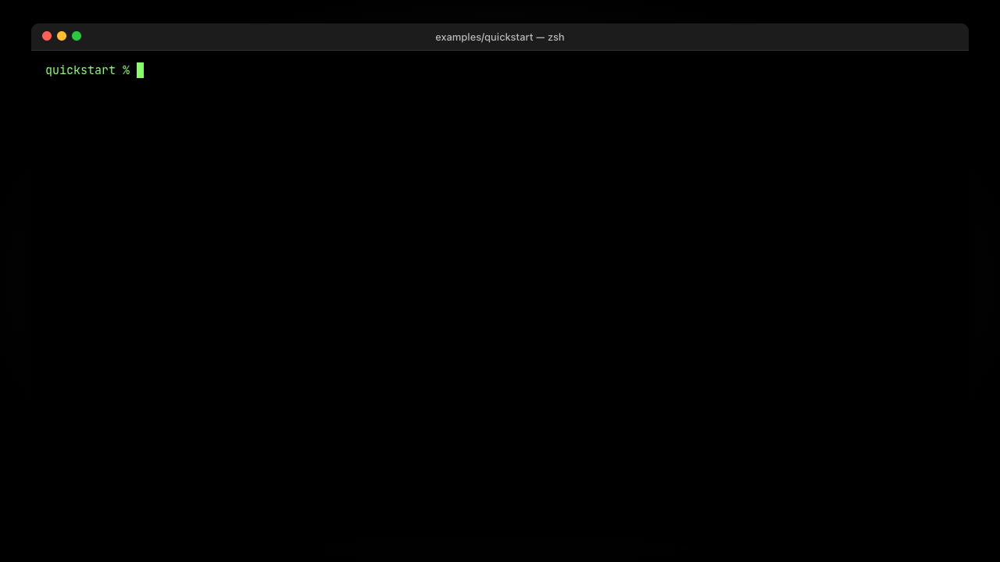

# Quickstart

The root README's "Use it in your project", as a project you can copy: one service,
`greet.v1.GreetService`, a server on `colibri.Server` and a client on `colibri.Client`, both on
Rotor and over TLS. `tools/package_check.sh` builds this folder against a fetched copy of
connect-zig on each push, so the README's steps stay true.



## Files

| Path | Holds |
| --- | --- |
| [build.zig.zon](build.zig.zon) | connect-zig as a dependency: a path here, a URL in your project |
| [build.zig](build.zig) | The modules, the plugin step and the two programs |
| [proto/greet/v1/greet.proto](proto/greet/v1/greet.proto) | The schema |
| [gen/](gen) | The code `buf generate` writes from it |
| [src/server.zig](src/server.zig) | The handler, the route table and the server |
| [src/client.zig](src/client.zig) | A client that calls Greet in Connect and in gRPC, over h2 and h3 |
| [check.sh](check.sh) | What `zig build test` runs: the server, the client and curl |

## Start your own

Copy this folder, then name connect-zig by URL in place of the path:

```sh
zig fetch --save=connect_zig git+https://github.com/c4milo/connect-zig
```

Then generate the code and build:

```sh
zig build plugin
buf generate
zig build
```

## Run it

The server reads its certificate chain and its key from files, as a real server does. The client
reads the CA it trusts. With the examples' test identity, from this folder:

```sh
zig-out/bin/greet-server 8443 ../harness/tls/chain.pem ../harness/tls/key.pem
```

```sh
zig-out/bin/greet-client 8443 ../harness/tls/ca.pem
curl --cacert ../harness/tls/ca.pem --json '{"name":"Ada"}' \
  https://127.0.0.1:8443/greet.v1.GreetService/Greet
```

`zig build test` does all three, on a port the kernel chooses. `-Didentity=<dir>` names another
folder of `chain.pem`, `key.pem` and `ca.pem`.
