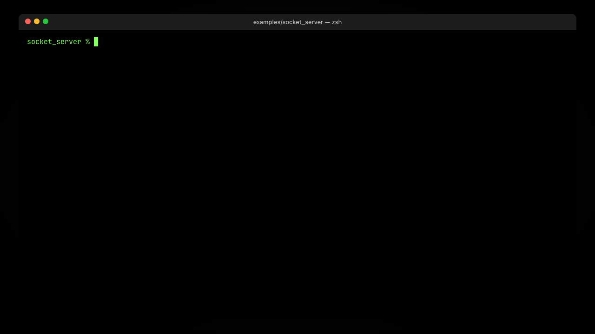

# The socket server

The service of each example project under one router, on a real socket: ELIZA, the streaming,
interceptors and errors services, the GitHub-style API, the account service behind OpenID
Connect tokens, and OpenTelemetry's trace receiver. It depends on each of those projects by path, and imports the service each
exports, so its own code is the `App` that holds each service's room and the route table
(decision 41).



```sh
zig build serve -- 8443
```

It serves h11 and h2 over TLS on the TCP port, and h3 on the UDP socket of the same port, under the
examples' test identity (decision 25). It reads gzip, zstd and br messages, and answers in the
one a client accepts first. Port 0 lets the kernel choose, and the server prints `listening on port
<port>`.

From the root of the repository, `zig build run-eliza-server -- [port]` runs it, and `zig build`
installs it as `zig-out/bin/eliza-server`. `tools/interop_check.sh` starts that binary and calls
each service with curl and buf curl, in Connect, gRPC and gRPC-Web, over h11, h2 and h3. The
README of each project lists the calls of its service; each works on this server too. The check
also runs `interop/otel`, which exports spans with OpenTelemetry's Go SDK and reads them back.
