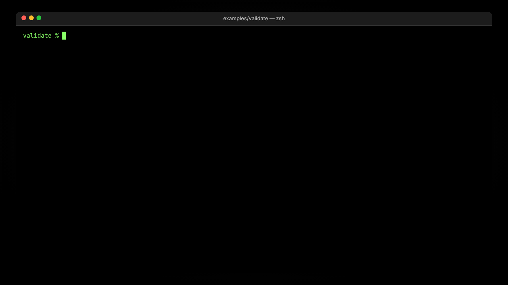

# Validate

`signup.v1.SignupService` behind `protovalidate.Interceptor`, which checks each request message
against the rules its schema states with [protovalidate](https://github.com/bufbuild/protovalidate)'s
options:

- [signup.proto](proto/signup/v1/signup.proto) states the rules of `RegisterRequest`: an email
  address, a name of 1 to 64 characters, an age from 13 to 149, and at most 4 tags, each one
  different;
- the plugin writes the rules beside the generated message, and the interceptor reads them when
  the program compiles, so no rule is parsed at run time;
- a message that breaks a rule ends its call with `invalid_argument` before a handler takes it.
  The error's message names the first violation, and its detail is a `buf.validate.Violations`
  that holds each one;
- `RegisterMany` takes a stream: the interceptor checks each message as the handler asks for it,
  and the first one that breaks a rule ends the stream.



## Files

| Path | Holds |
| --- | --- |
| [proto/signup/v1/signup.proto](proto/signup/v1/signup.proto) | The schema and its rules |
| [proto/buf.yaml](proto/buf.yaml) | The buf module, which takes validate.proto from the Buf Schema Registry |
| [src/service/service.zig](src/service/service.zig) | The handlers, the interceptor and the values of a call |
| [src/app.zig](src/app.zig) | This example's `App` and route table |
| [src/main.zig](src/main.zig) | The check, over h2, h11 and h3 |
| [src/serve.zig](src/serve.zig) | The same routes on a socket, to play with |

## Run it

```sh
zig build run
```

## Play with it

```sh
zig build serve
```

From this folder, an account that keeps the rules:

```sh
curl --cacert ../harness/tls/ca.pem --json '{"email":"ada@example.com","name":"Ada","age":36}' \
  https://127.0.0.1:8443/signup.v1.SignupService/Register
```

It answers `{"name":"Ada"}`. An account that breaks two rules:

```sh
curl -i --cacert ../harness/tls/ca.pem --json '{"email":"ada","name":"Ada","age":7}' \
  https://127.0.0.1:8443/signup.v1.SignupService/Register
```

It fails with 400 and `invalid_argument`. The message is "email: must be a valid email address
(and 1 more)", and the detail of type `buf.validate.Violations` holds both violations.

## In a project of your own

- Name protovalidate in your `buf.yaml`, as [proto/buf.yaml](proto/buf.yaml) does, and run
  `buf dep update`.
- Give a generated file that holds rules the module `protovalidate`: its header names it.
- Declare the interceptor's room in your route table's `.Values`, and list the interceptor in
  the route options, as [src/service/service.zig](src/service/service.zig) does.
- A rule that reads the time, such as `timestamp.lt_now`, takes it from a field
  `protovalidate_now` of your `App`, which your program writes from its clock.
